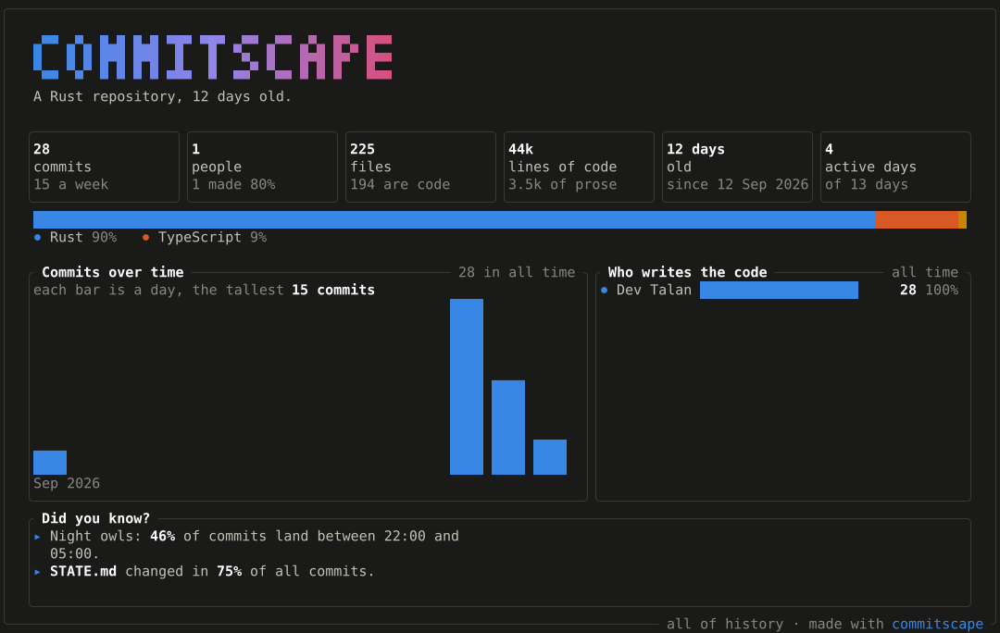

[English](../../README.md) · [简体中文](./README.zh-CN.md) · [日本語](./README.ja.md) · [한국어](./README.ko.md) · **Español** · [Português](./README.pt-BR.md) · [Deutsch](./README.de.md) · [Français](./README.fr.md) · [हिन्दी](./README.hi.md)

<div align="center">
  
  <h1>commitscape</h1>
  <p>Lo que has construido, cómo estás frente a la gente con la que trabajas, y tarjetas para compartirlo.</p>
</div>

<p align="center">
  <a href="https://github.com/pixelactstudio/commitscape/actions/workflows/ci.yml">
    
  </a>
  <a href="https://github.com/pixelactstudio/commitscape/actions/workflows/docker.yml">
    
  </a>
  <a href="#license">
    
  </a>
</p>

commitscape le muestra a quien programa lo que ha construido: pull requests fusionadas, revisiones hechas y las líneas suyas que siguen en marcha, contadas con blame a partir de la propia historia de cada repositorio. Muestra cómo está frente a la gente con la que trabaja, vista por vista y nunca con una puntuación única, y lo convierte en tarjetas (Cards) para un README, una autoevaluación o una publicación. Lee toda la historia de un repositorio grande en segundos, a partir de los datos del propio git.



Hay dos formas de usarlo:

1. **Desde la terminal.** Ejecuta `npx commitscape` en cualquier repositorio git. Te dice qué va a subir y pregunta antes (Enter significa sí), lee la historia en tu máquina, sube el informe (Report) cerrado con una clave que solo tiene el enlace y abre el enlace en tu navegador. El enlace dura 4 horas, y el sitio (Site) no puede leer lo que guarda.
2. **En el sitio.** Entra con GitHub y escribe cualquier usuario de GitHub para ver su perfil (Profile): totales, líneas que sobreviven (Surviving Lines), arquetipo (Archetype) y logros (Achievements), dónde está su trabajo, tarjetas para incrustar, prueba de trabajo (Proof of Work) de un periodo, Versus y Wrapped. Pega el enlace de un repositorio para ver su informe y su clasificación (Standings), o elige tus propios repositorios, también los privados. Cualquiera puede quedar fuera de las comparaciones.

El proyecto está en una fase temprana. La CLI y el sitio funcionan de principio a fin.

## Primeros pasos

```sh
npx commitscape
```

```text
This uploads my-project's Report to https://app.commitscape.com.
  It holds file paths, people's names and GitHub logins, and commit subjects. No email addresses.
  It is locked with a key only the link holds, so the Site cannot read it.
  The link works for 4 hours.
Upload it? [Y/n]
https://app.commitscape.com/s/k3f9q2x7#0dbf…
```

`--no-open` imprime el enlace sin abrir el navegador, `--yes` sube sin preguntar (para scripts; nunca abre el navegador) y `--expires 12` mantiene el enlace 12 horas. `commitscape share --list` lista los enlaces que ha creado esta máquina y `--delete <link>` retira uno.

## Instalación

| Cómo | Comando |
|---|---|
| npm | `npx commitscape`, `pnpm dlx commitscape` o `npm install -g commitscape` |
| Homebrew | `brew install pixelactstudio/commitscape/commitscape` |
| winget | `winget install DevTalan.Commitscape` |
| Scoop | `scoop bucket add pixelactstudio https://github.com/pixelactstudio/scoop-bucket` y después `scoop install commitscape` |
| Arch (AUR) | `yay -S commitscape-bin` |
| Debian, Ubuntu | el `.deb` de la [última versión](https://github.com/pixelactstudio/commitscape/releases/latest): `sudo apt install ./commitscape_*_amd64.deb` |
| Fedora, RHEL | el `.rpm` de la última versión: `sudo dnf install ./commitscape-*.x86_64.rpm` |
| Cargo | `cargo install commitscape` |
| Nix | `nix run github:pixelactstudio/commitscape` |
| Un binario | el archivo de tu plataforma en la última versión |

Hay binarios compilados para Linux en x64 y ARM (glibc o musl), macOS en Intel y Apple silicon, y Windows en x64. El paquete de npm instala solo el binario de tu plataforma, no ejecuta nada al instalarse y no necesita Node para funcionar.

## Comandos

| Comando | Qué hace |
|---|---|
| `commitscape [path]` | Lo mismo que `commitscape share`: pregunta, sube el informe cerrado y abre su enlace |
| `commitscape share [path]` | Un enlace cerrado al informe de este repositorio, para cualquier navegador; `--list` y `--delete <link>` los gestionan |
| `commitscape surviving [path] --person <id>` | Las líneas que sobreviven de una persona: las líneas en la cabeza que blame le atribuye, atravesando los commits de formato |
| `commitscape health <owner/name>` | Si un proyecto de GitHub sigue vivo y si depende de una sola persona |

`--help` en cualquier comando muestra todas las opciones.

## Tarjetas en un README

La [card action](../../actions/card) guarda tarjetas del sitio en tu repositorio y las mantiene al día según una programación:

```yaml
- uses: pixelactstudio/commitscape/actions/card@v1
  with:
    cards: |
      u/octocat/totals?theme=dark .github/cards/totals.svg
```

También puedes incrustar directamente la dirección de una tarjeta del sitio; su estudio de tarjetas en `/u/<login>/cards` da la dirección de cada una. Las tarjetas se abren sin iniciar sesión, así que los README pueden mostrarlas.

## En el sitio

- **Cualquier repositorio público de GitHub.** Ve a `/gh/<owner>/<name>`. Los datos de GitHub aparecen al instante, y el informe llega cuando se ha leído su historia: segundos en la mayoría de los repositorios. Las líneas cambiadas (Lines Changed) llegan después, primero las de la rama principal.
- **Tus propios repositorios.** Elige repositorios con la GitHub App de commitscape, que solo puede leer. El informe de un repositorio privado solo se muestra a quien GitHub dice que puede verlo.
- **Abierto a cualquiera.** Las tarjetas, los informes compartidos (Shared Reports) y las pruebas de trabajo compartidas. Todas las demás páginas piden entrar con GitHub, así que lo que abres se lee con tu propio cupo de GitHub.
- **Para clientes MCP.** Cuando el sitio configura un token, `/mcp` busca un repositorio y lee su informe, perfiles y clasificación.

`/privacy` en el sitio explica qué guarda, dónde, durante cuánto tiempo y quién puede leerlo.

## Privacidad

En tu máquina, commitscape no envía ningún repositorio a ningún sitio hasta que dices que sí:

- `share` (y `commitscape` a secas) sube el informe cifrado con AES-256-GCM. La clave solo está en el enlace, después del `#`, que los navegadores nunca envían, así que el sitio guarda algo que no puede leer. Nunca incluye direcciones de correo.
- `surviving` lee el repositorio en tu máquina (si le das una dirección de GitHub, lo clona). `health` pregunta a GitHub, mediante la [CLI de GitHub](https://cli.github.com), por el proyecto que le das.
- Cada ejecución de `share`, `health`, `surviving` o `report` envía al sitio un recuento de uso anónimo: el comando, cuánto tardó, cómo terminó, la versión y tu plataforma, con un id aleatorio. Nunca una ruta ni nada de un repositorio. `COMMITSCAPE_TELEMETRY=0` o `DO_NOT_TRACK=1` lo desactiva.
- Sin comprobaciones de actualizaciones y sin nada que se ejecute al instalar.

En el sitio, ninguna dirección de correo sale del Builder: los packs con los que responde el servicio del motor no contienen ninguna.

## Cómo está construido

Un único motor en Rust lee la historia de git: dentro de la CLI en tu máquina y dentro del Builder para el sitio. El sitio nunca ejecuta git.


- **El sitio** (TanStack Start sobre Node) dibuja cada página en el servidor, para quien ha iniciado sesión. Guarda filas y la cola de compilaciones (Builds) en Postgres y archivos en R2, y pregunta al servicio del motor todo lo que exige recorrer la historia de un repositorio.
- **El servicio del motor (engine service)** (Rust, `apps/engine`) responde a partir de packs: cada uno es el índice (Index) de un repositorio en una cabeza, escrito por una compilación y nunca modificado. Trae un pack de R2 una sola vez y lo guarda en disco y en memoria, así que cualquier ventana (Window) de cualquier repositorio tarda milisegundos.
- **El Builder** toma compilaciones de la cola, clona el repositorio y ejecuta `commitscape build`.
- **La página de inicio** es estática, está en Cloudflare Workers, aparte del sitio.


Una compilación en frío ejecuta dos fases a la vez. Un clon sin el contenido antiguo de los archivos da el primer informe en segundos; un clon completo, que comparte la misma caché del motor, cuenta las líneas cambiadas: la línea principal (Mainline) primero, de lo más reciente a lo más antiguo, dentro de un presupuesto de tiempo, con compilaciones silenciosas después para lo que quede. Cada fase copia sus filas al índice guardado (Stored Index) en Postgres y sube un pack nuevo, y el servicio del motor trae ese pack la primera vez que le preguntan por él.


El loader de una página lee la clave del pack en Postgres, pregunta con ella al servicio del motor, y lee filas (páginas de commits, ramas, pull requests) de Postgres y archivos guardados (texto de archivos, el Atlas del Universe, tarjetas) de R2. Las respuestas se guardan en el servicio del motor y, comprimidas, en el sitio; las direcciones de un repositorio público fijadas a una compilación se guardan en caché un año.

| Carpeta | Qué contiene |
|---|---|
| `crates/` | Rust: el motor que lee git, las métricas, el informe y la CLI |
| `apps/site/` | El sitio: TanStack Start sobre Node, renderizado en el servidor, con Better Auth |
| `apps/engine/` | El servicio del motor: responde a las preguntas del sitio a partir de packs (axum, tokio) |
| `apps/builder/` | El Builder: toma compilaciones de una cola en Postgres, clona el repositorio, ejecuta `commitscape build`, carga el índice guardado en Postgres y sube el pack a R2 |
| `apps/landing/` | La página de inicio: HTML estático dibujado al compilar, para Cloudflare Workers |
| `packages/server/` | El esquema y las migraciones de la base de datos, el almacenamiento en R2, la cola y el cargador del índice guardado |
| `packages/ui/` | Cada pantalla y gráfico que muestra el sitio |
| `packages/data/` | Los tipos del informe, generados desde Rust, y las fuentes de datos |

Estos documentos están en inglés:

- [Lenguaje del dominio](../../CONTEXT.md)
- [Decisiones de arquitectura](../adr), la más reciente [ADR-0028](../adr/0028-the-engine-service-answers-from-immutable-packs.md)
- [Cómo encajan las piezas](../working.md)
- [El índice guardado en Postgres](../index-in-postgres.md)
- [Los límites de la API de GitHub](../github-api.md)
- [Despliegue](../../DEPLOY.md)
- [Publicación de versiones](../../RELEASING.md)

## Alojarlo tú mismo

El sitio, el servicio del motor y el Builder se publican como imágenes de Docker con cada fusión y cada versión. [DEPLOY.md](../../DEPLOY.md) explica cómo ejecutarlos en Dokploy, en uno o dos servidores, con Postgres, un bucket de Cloudflare R2 y la página de inicio en Cloudflare Workers.

## Desarrollo

Requisitos: Rust (stable), Node.js 24, pnpm 12 y Docker.

```sh
git clone git@github.com:pixelactstudio/commitscape.git
cd commitscape
pnpm install
pnpm services
cargo xtask fixtures --force
cargo build --release -p commitscape
cp apps/site/.env.example apps/site/.env
cp apps/builder/.env.example apps/builder/.env
cp apps/engine/.env.example apps/engine/.env
pnpm dev:engine
pnpm dev:builder
pnpm dev:site
```

`pnpm services` arranca Postgres y un sustituto de S3 en Docker. Pon `BETTER_AUTH_SECRET` en `apps/site/.env` (`openssl rand -hex 32`). El sitio funciona en [http://localhost:3100](http://localhost:3100), el servicio del motor en el puerto 4100, y `pnpm dev:landing` dibuja la página de inicio en [http://localhost:3200](http://localhost:3200). El inicio de sesión con GitHub, Sentry y PostHog quedan apagados mientras sus claves estén vacías.

| Comando | Para qué |
|---|---|
| `cargo test --workspace` | Todas las pruebas de Rust, incluidas las respuestas de referencia del servicio del motor |
| `cargo clippy --workspace --all-targets -- -D warnings` | Lints de Rust |
| `cargo xtask check-layering` | Comprueba que los crates dependen unos de otros solo como está diseñado |
| `pnpm check` | Comprobación de tipos, lint, pruebas y compilación de cada paquete TypeScript |
| `pnpm e2e` | El sitio, el servicio del motor y el Builder de principio a fin en Chromium, con comprobaciones de accesibilidad |
| `pnpm db:generate` | Escribe la migración de un cambio de esquema |
| `cargo xtask bench` | Tiempos en repositorios grandes |

## Tecnologías

- Rust, gix e imara-diff; axum y tokio para el servicio del motor
- TanStack Start, React 19, TypeScript y Vite
- Astryx y Tailwind CSS
- PostgreSQL, Drizzle ORM, pg-boss y Cloudflare R2
- Better Auth, PostHog y Sentry
- Turborepo, oxlint, Vitest y Playwright

## Convención de commits

Los commits y los títulos de las pull requests siguen [Conventional Commits](https://www.conventionalcommits.org/). Las versiones, sus números y el registro de cambios se generan a partir de ellos ([RELEASING.md](../../RELEASING.md)):

```text
feat: count lines changed per person
fix: keep the Window when opening a file
chore: update dependencies
```

<a name="license"></a>

## Licencia

commitscape es software de código abierto, con licencia [MIT](../../LICENSE-MIT) o [Apache 2.0](../../LICENSE-APACHE), a tu elección. Copyright 2026 Dev Talan.

Un proyecto de código abierto de [Pixelact Studio](https://pixelactstudio.com).
